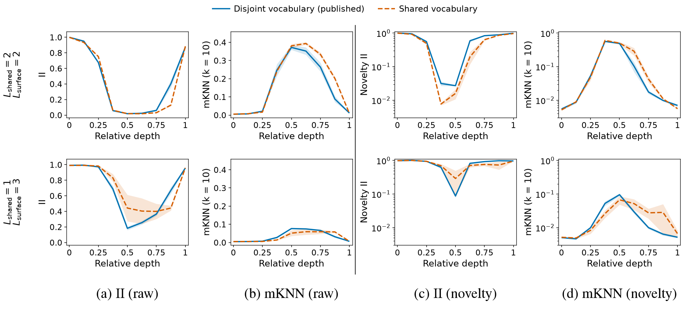

# Cross-language alignment with shared and disjoint vocabularies

This is the supplementary figure. All setups (MRHM and training details) are the same as in the paper, except that the two synthetic languages share their vocabulary (dashed) instead of using disjoint vocabularies (solid). We plot cross-lingual similarity across the layers of transformers trained on both languages. Top: L_shared = 2, L_surface = 2. Bottom: L_shared = 1, L_surface = 3. (a, b) Raw representations: Information Imbalance (II; lower is more similar) and mutual k-nearest neighbours (mKNN, k = 10; higher is more similar). (c, d) The same for layerwise novelty, on a log scale.

[Vector PDF](mrhm-shared-vs-disjoint-vocabulary-alignment.pdf) · [PNG](mrhm-shared-vs-disjoint-vocabulary-alignment.png)

